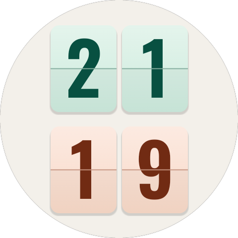
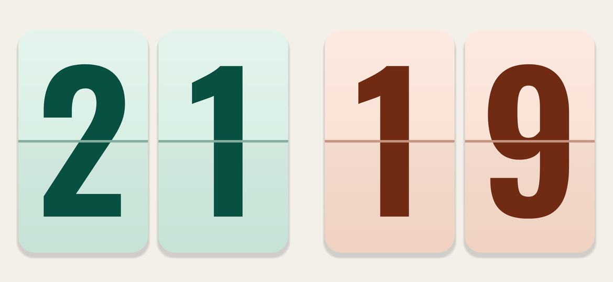

# 배드민턴 점수판

경기하는 선수가 직접 워치(또는 폰)로 점수를 올리고 내리는 점수판.
Galaxy Watch7(Wear OS)과 Galaxy S25 Ultra(Android) 어느 쪽에서 눌러도 두 기기의 점수가 같이 바뀐다.
서버도 인터넷도 쓰지 않고, 워치와 폰이 Wearable Data Layer로 직접 통신한다.

| 워치 (위 = 나, 아래 = 상대) | 폰 (왼쪽 = 나, 오른쪽 = 상대) |
| :---: | :---: |
|  |  |

플립 시계 모양이다. 점수가 바뀌면 바뀐 자리의 카드만 넘어간다 (아래는 21:19 → 22:20 으로 넘어가는 중).


## 조작

워치와 폰이 똑같다. 화면 전체가 큰 버튼 두 개다.

| 동작 | 결과 | 진동 |
| --- | --- | --- |
| 짧게 누르기 | +1 | 나: 짧게 1번 / 상대: 짧게 2번 |
| 길게 누르기 (0.5초) | −1 (0점 아래로는 안 내려감) | 길게 1번 |
| 두 버튼 함께 길게 누르기 (0.8초) | 새 게임 (0:0) | 길게 2번 |

- −1과 새 게임은 손을 떼기 전, 시간이 찬 순간에 바로 실행되고 진동이 온다.
- 두 버튼이 함께 눌리면 각각의 −1은 취소된다. 0.8초 전에 떼면 아무 일도 일어나지 않는다.
- +1 직후 같은 버튼은 잠깐 입력을 무시한다 (오터치 방지, 워치 0.4초 / 폰 0.3초).
- 카드 바깥 여백을 포함해 화면의 각 절반 전체가 버튼이다. 누르고 있는 동안 그쪽 카드가 살짝 진해지며 눌려 들어간다.
- 손가락이 처음 닿은 쪽 버튼으로 판정하므로, 누른 채로 미끄러져도 다른 버튼으로 넘어가지 않는다.
- 워치는 폰에서 바뀐 점수도 같은 패턴의 진동으로 알려준다.
- 워치는 옆으로 쓸어도 닫히지 않는다. 종료는 워치의 뒤로/홈 버튼으로 한다.

## 프로젝트 구조

```
shared/   점수 상태·규칙, 제스처 판정, 진동, Data Layer 동기화, 공통 UI 부품
phone/    폰 앱 (가로 고정 전광판)
wear/     워치 앱 (원형 화면, Compose for Wear OS)
```

| 파일 | 역할 |
| --- | --- |
| `shared/.../model/ScoreState.kt` | 점수 + 타임스탬프, +1 / −1 / 리셋, 최신 판정 |
| `shared/.../gesture/TwoButtonGesture.kt` | 짧게 / 길게 / 동시 길게 판정 (타이밍 값 `GestureConfig`) |
| `shared/.../gesture/TwoButtonInput.kt` | 터치 이벤트를 위 판정기에 연결하는 Compose Modifier |
| `shared/.../haptics/Haptics.kt` | 진동 패턴 (길이 조정은 이 파일 상수) |
| `shared/.../sync/ScoreSync.kt` | 워치 ↔ 폰 동기화 |
| `shared/.../ScoreboardViewModel.kt` | 위의 것들을 묶는 공통 로직, 점수 저장 |
| `shared/.../ui/ScoreColors.kt` | 바탕·카드·숫자 색 |
| `shared/.../ui/FlipScore.kt` | 플립 카드 그리기와 넘어가는 애니메이션 (속도는 `FLIP_MS`) |
| `phone/.../PhoneScoreboard.kt`, `wear/.../WearScoreboard.kt` | 각 기기 화면 배치, 기기별 타이밍 값 |

### 동기화 방식

점수가 바뀔 때마다 전체 상태(내 점수, 상대 점수, 타임스탬프)를 두 경로로 보낸다.

- `MessageClient`: 지금 연결된 기기에 즉시 전달
- `DataClient`: 기기에 저장되어, 끊겨 있었거나 앱이 꺼져 있던 기기가 나중에 받아감

받는 쪽은 타임스탬프가 더 최신일 때만 반영한다. 두 기기의 시계가 조금 달라도
방금 본 상태에서 만든 변경은 항상 그보다 최신이 되도록 타임스탬프를 매긴다.
상대 기기가 없으면 전송만 조용히 실패하고 각 기기는 단독으로 동작한다.

## 빌드와 설치

Android Studio에서 이 폴더를 열면 실행 구성에 `phone`과 `wear`가 생긴다.
폰과 워치를 각각 연결(워치는 개발자 옵션의 무선 디버깅)하고 하나씩 실행한다.

명령줄로는:

```
./gradlew :phone:installDebug     # 폰이 연결된 상태에서
./gradlew :wear:installDebug      # 워치가 연결된 상태에서
./gradlew :shared:testDebugUnitTest
./gradlew :phone:testDebugUnitTest :wear:testDebugUnitTest   # 화면 미리보기 PNG 생성
```

미리보기는 `phone/build/screenshots`, `wear/build/screenshots`에 저장된다. 기기 없이 UI를 고칠 때 쓴다.

기기가 둘 다 연결돼 있으면 `ANDROID_SERIAL=<기기 ID>`로 대상을 고른다 (`adb devices`로 확인).

**동기화가 되려면 두 앱의 applicationId와 서명 키가 같아야 한다.**
같은 PC에서 디버그 빌드로 두 기기에 설치하면 자동으로 맞는다.

## 실기기에서 확인할 것

에뮬레이터 없이 단위 테스트와 화면 렌더링까지만 확인했다. Watch7 + S25 Ultra에서 직접 봐야 하는 항목:

- [ ] 워치에서 누르면 폰이, 폰에서 누르면 워치가 바로 따라오는지 (지연 체감)
- [ ] 블루투스를 껐다 켠 뒤 최신 점수로 맞춰지는지
- [ ] 진동 4가지가 손목에서 구분되는지 (`Haptics.kt`의 길이 상수로 조정)
- [ ] 땀 난 손으로 눌렀을 때 오터치 정도 (`WearScoreboard.kt`의 `tapLockoutMs`로 조정)
- [ ] 워치에서 옆으로 쓸어도 앱이 닫히지 않는지
- [ ] 경기 내내 두 기기 화면이 켜져 있는지, 배터리 소모가 감당할 만한지

워치 설정의 "손바닥으로 덮어 화면 끄기" 같은 시스템 제스처는 앱에서 막을 수 없으니, 방해되면 워치 설정에서 꺼 둔다.

## 글꼴

점수 숫자는 [Oswald](https://github.com/googlefonts/OswaldFont) SemiBold를 쓴다 (SIL Open Font License 1.1, `shared/licenses/`).
