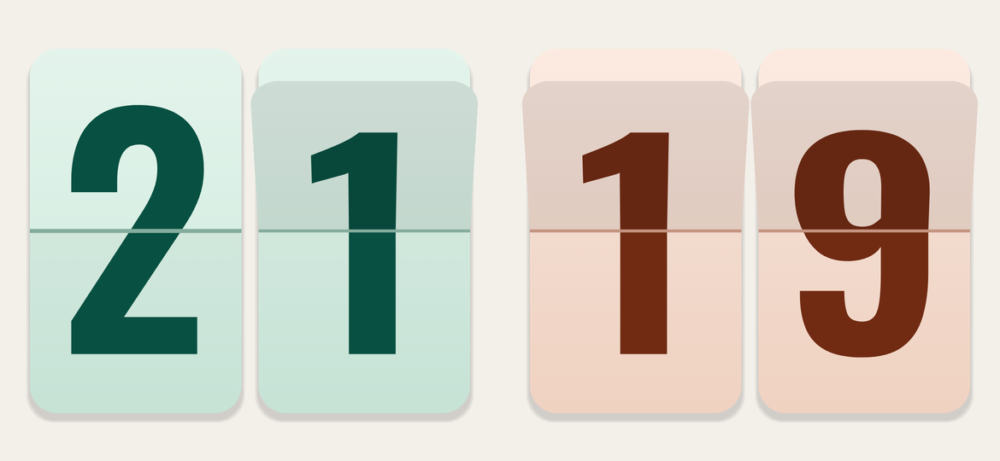
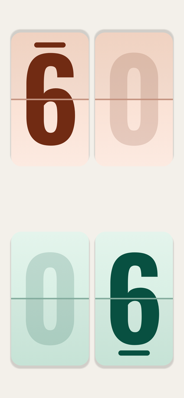
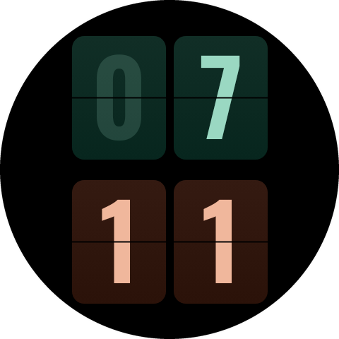
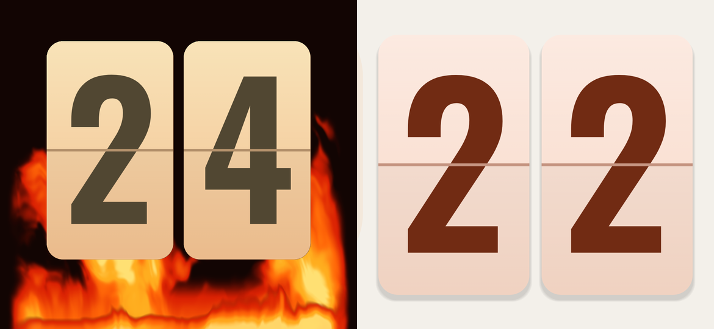
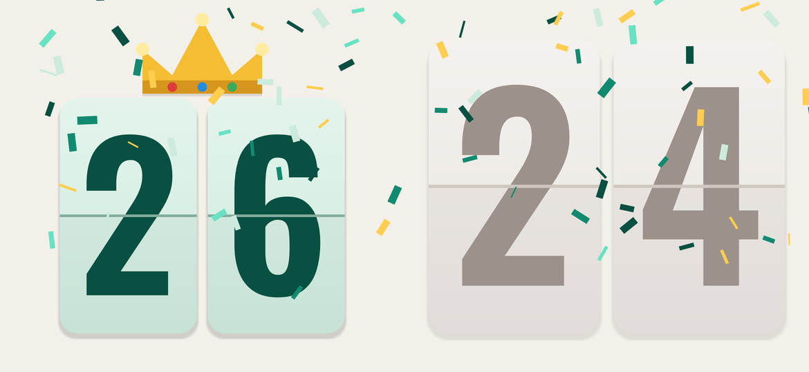

# 배드민턴 점수판

경기하는 선수가 직접 워치(또는 폰)로 점수를 올리고 내리는 점수판.
Galaxy Watch7(Wear OS)과 Galaxy S25 Ultra(Android) 어느 쪽에서 눌러도 두 기기의 점수가 같이 바뀐다.
서버도 인터넷도 쓰지 않고, 워치와 폰이 Wearable Data Layer로 직접 통신한다.

| 워치 (위 = 나, 아래 = 상대) | 폰 가로 (왼쪽 = 나, 오른쪽 = 상대) |
| :---: | :---: |
|  |  |

플립 시계 모양이다. 점수가 바뀌면 바뀐 자리의 카드만 넘어간다 (아래는 21:19 → 22:20 으로 넘어가는 중).



## 조작

워치와 폰이 똑같다. 화면 전체가 큰 버튼 두 개다.

| 동작 | 결과 | 진동 |
| --- | --- | --- |
| 짧게 누르기 | +1 | 나: 짧게 1번 / 상대: 짧게 2번 |
| 길게 누르기 (0.5초) | −1 (0점 아래로는 안 내려감) | 길게 1번 |
| 두 버튼 함께 길게 누르기 (0.8초) | 새 게임 (0:0) | 길게 2번 |

- −1과 새 게임은 손을 떼기 전, 시간이 찬 순간에 바로 실행되고 진동이 온다.
- 두 버튼이 함께 눌리면 각각의 −1은 취소된다. 0.8초 전에 떼면 아무 일도 일어나지 않는다.
- +1 직후 같은 버튼은 잠깐 입력을 무시한다 (오터치 방지, 워치 0.4초 / 폰 0.3초).
- 폰은 가로로 두면 좌/우(왼쪽 = 나), 세로로 두면 위/아래로 점수가 나온다. 상단바 없이 화면 전체를 쓴다.
- **폰 세로는 네트 아래 바닥에 눕혀 두는 배치**다. 아래 = 나(똑바로), 위 = 상대(180° 뒤집힘)라서
  양쪽 선수가 각자 자기 쪽에서 자기 점수를 똑바로 읽는다. 불길·왕관·꽃가루 같은 효과도 각 선수 쪽으로 나온다.
  바닥에 눕히면 그때 화면 방향이 고정되고, 다시 세우면 자동 회전으로 돌아간다.

  
- 6과 9는 뒤집어 봐도 헷갈리지 않게 당구공처럼 아래에 밑줄이 있다.
- 카드 바깥 여백을 포함해 화면의 각 절반 전체가 버튼이다. 누르고 있는 동안 그쪽 카드가 살짝 진해지며 눌려 들어간다.
- 손가락이 처음 닿은 쪽 버튼으로 판정하므로, 누른 채로 미끄러져도 다른 버튼으로 넘어가지 않는다.
- 워치는 폰에서 바뀐 점수도 같은 패턴의 진동으로 알려준다.
- 워치에서 점수판을 켜면 연결된 폰의 점수판 앱도 자동으로 켜지고 점수가 맞춰진다. 폰이 잠겨 있으면 잠금화면 위에 뜬다.
  이를 위해 폰 앱을 설치한 뒤 **한 번 직접 열어서** 알림과 "다른 앱 위에 표시"를 허용해야 한다.
  "다른 앱 위에 표시"를 허용하지 않으면 바로 켜지는 대신 "점수판 열기" 알림이 뜬다.
- 워치는 5초 동안 입력이 없으면 검은 바탕의 절전 화면으로 바뀐다 (배터리 절약). 절전 화면에서도 점수는 보이고 터치는 한 번에 그대로 인식되며, 누르거나 점수가 바뀌면 바로 밝아진다.

  
- **매치포인트·듀스에는 불이 붙는다** (25점 경기, 2점 차 승리, 상한 없음).
  - 매치포인트(한 점만 더 내면 이기는 쪽): 그쪽만, 듀스(24:24부터 동점): 양쪽 모두
  - 그쪽 화면이 어두워지고 아래에서 불길이 타오르며, 카드는 불에 달궈진 듯 주황빛으로 달아오른다.
  - 불길은 GPU 셰이더로 그린다 (안드로이드 13 이상, 그 아래는 단순한 불꽃). 워치 절전 화면에서는 꺼진다.

  
- **경기가 끝나면** (25점 이상, 2점 차) 누가 이기든 같은 효과가 나온다: 이긴 쪽 점수 위로 왕관이 떨어져 내려앉고,
  이긴 쪽 색의 꽃가루가 4초간 쏟아진다. 진 쪽 카드는 회색으로 흐려지고, 경기마다 무작위로 비구름(4초간 비) · 금 간 카드 · 흰 깃발 · 축 처진 카드 중 하나가 나온다.
  폰과 워치는 같은 경기에서 같은 효과를 보여 준다.
  양쪽 카드가 똑같이 줄어 왕관·구름 자리를 내므로 두 점수의 글자 크기는 같다. 승리 진동(길게-짧게-짧게-길게)도 울린다.
  새 게임은 평소처럼 두 버튼을 함께 0.8초 누른다.

  
- 폰은 4~7점마다 한 번씩 "태민 화이팅!" 하고 여자 목소리로 응원한다. 소리 크기는 폰의 미디어 음량을 따른다.
- 워치는 옆으로 쓸어도 닫히지 않는다. 종료는 워치의 뒤로/홈 버튼으로 한다.

## 프로젝트 구조

```
shared/   점수 상태·규칙, 제스처 판정, 진동, Data Layer 동기화, 공통 UI 부품
phone/    폰 앱 (전광판, 가로·세로 모두 지원)
wear/     워치 앱 (원형 화면, Compose for Wear OS)
```

| 파일 | 역할 |
| --- | --- |
| `shared/.../model/ScoreState.kt` | 점수 + 타임스탬프, +1 / −1 / 리셋, 최신 판정 |
| `shared/.../gesture/TwoButtonGesture.kt` | 짧게 / 길게 / 동시 길게 판정 (타이밍 값 `GestureConfig`) |
| `shared/.../gesture/TwoButtonInput.kt` | 터치 이벤트를 위 판정기에 연결하는 Compose Modifier |
| `shared/.../haptics/Haptics.kt` | 진동 패턴 (길이 조정은 이 파일 상수) |
| `shared/.../sync/ScoreSync.kt` | 워치 ↔ 폰 동기화 |
| `shared/.../cheer/CheerSchedule.kt` | 응원을 몇 점마다 낼지 (기본 4~7점) |
| `phone/.../CheerVoice.kt` | 응원 음성 (글자 읽어주기, 문구는 `phone/.../strings.xml`의 `cheer_text`) |
| `shared/.../model/GameRules.kt` | 매치포인트·듀스·승리 판단 (경기 점수 `GAME_POINT` = 25) |
| `shared/.../ui/Confetti.kt` | 승리 꽃가루 |
| `shared/.../ui/LoserEffect.kt` | 진 쪽 효과 목록과 무작위 선택 |
| `shared/.../ui/FireBackground.kt` | 불길 셰이더와 어두운 배경 |
| `shared/.../sync/PhoneLaunch.kt` | 워치가 폰에 보내는 "점수판 열기" 신호 |
| `phone/.../FlatOrientationHold.kt` | 폰을 바닥에 눕히면 화면 방향 고정 |
| `phone/.../OpenFromWatchService.kt` | 그 신호를 받아 폰 점수판을 띄우거나 알림을 보여 줌 |
| `shared/.../ScoreboardViewModel.kt` | 위의 것들을 묶는 공통 로직, 점수 저장 |
| `shared/.../ui/ScoreColors.kt` | 바탕·카드·숫자 색 |
| `shared/.../ui/FlipScore.kt` | 플립 카드 그리기와 넘어가는 애니메이션 (속도는 `FLIP_MS`) |
| `phone/.../PhoneScoreboard.kt`, `wear/.../WearScoreboard.kt` | 각 기기 화면 배치, 기기별 타이밍 값, 워치 절전 시간(`REST_AFTER_MS`) |

### 동기화 방식

점수가 바뀔 때마다 전체 상태(내 점수, 상대 점수, 타임스탬프)를 두 경로로 보낸다.

- `MessageClient`: 지금 연결된 기기에 즉시 전달
- `DataClient`: 기기에 저장되어, 끊겨 있었거나 앱이 꺼져 있던 기기가 나중에 받아감

받는 쪽은 타임스탬프가 더 최신일 때만 반영한다. 두 기기의 시계가 조금 달라도
방금 본 상태에서 만든 변경은 항상 그보다 최신이 되도록 타임스탬프를 매긴다.
상대 기기가 없으면 전송만 조용히 실패하고 각 기기는 단독으로 동작한다.

## 빌드와 설치

Android Studio에서 이 폴더를 열면 실행 구성에 `phone`과 `wear`가 생긴다.
폰과 워치를 각각 연결(워치는 개발자 옵션의 무선 디버깅)하고 하나씩 실행한다.

명령줄로는:

```
./gradlew :phone:installDebug     # 폰이 연결된 상태에서
./gradlew :wear:installDebug      # 워치가 연결된 상태에서
./gradlew :shared:testDebugUnitTest
./gradlew :phone:testDebugUnitTest :wear:testDebugUnitTest   # 화면 미리보기 PNG 생성
```

미리보기는 `phone/build/screenshots`, `wear/build/screenshots`에 저장된다. 기기 없이 UI를 고칠 때 쓴다.

기기가 둘 다 연결돼 있으면 `ANDROID_SERIAL=<기기 ID>`로 대상을 고른다 (`adb devices`로 확인).

**동기화가 되려면 두 앱의 applicationId와 서명 키가 같아야 한다.**
같은 PC에서 디버그 빌드로 두 기기에 설치하면 자동으로 맞는다.

### 워치에 설치하기 (Galaxy Watch7)

워치에는 USB 단자가 없어서 Wi-Fi로 PC와 연결한다. 워치와 PC가 같은 Wi-Fi에 있어야 한다.

1. **개발자 옵션 켜기**: 워치에서 설정 → 워치 정보 → 소프트웨어 정보 → "소프트웨어 버전"을 7번 누른다.
2. **무선 디버깅 켜기**: 설정 → 개발자 옵션 → "ADB 디버깅"을 켜고, "무선 디버깅"을 켠다.
3. **페어링**: 무선 디버깅 → "새 기기 등록"을 누르면 IP 주소:포트와 6자리 코드가 나온다. PC에서

   ```
   adb pair 192.168.0.12:37123      # 워치에 표시된 주소:포트, 이어서 코드 입력
   ```

4. **연결**: 무선 디버깅 화면 맨 위에 표시된 "IP 주소 및 포트"로 연결한다 (페어링 때와 포트가 다르다).

   ```
   adb connect 192.168.0.12:41035
   adb devices                      # 워치가 목록에 보이면 성공
   ```

5. **설치**:

   ```
   adb -s 192.168.0.12:41035 install -r wear-debug.apk
   # 또는 소스에서: ANDROID_SERIAL=192.168.0.12:41035 ./gradlew :wear:installDebug
   ```

설치되면 워치 앱 목록에 "배드민턴 점수판"이 생긴다. Android Studio를 쓴다면 Device Manager의
"Pair Devices Using Wi-Fi"에서 "Pair using pairing code"로 3~4단계를 대신할 수 있다.

`adb`는 Android Studio에 들어 있고, 따로 받으려면 Android "SDK Platform-Tools"를 설치한다.
무선 디버깅은 배터리를 쓰므로 설치가 끝나면 꺼 둔다.

## 실기기에서 확인할 것

에뮬레이터 없이 단위 테스트와 화면 렌더링까지만 확인했다. Watch7 + S25 Ultra에서 직접 봐야 하는 항목:

- [ ] 워치에서 앱을 켜면 폰 앱이 따라 켜지는지 (폰 화면이 꺼져 있을 때, 잠겨 있을 때 포함)
- [ ] 워치에서 누르면 폰이, 폰에서 누르면 워치가 바로 따라오는지 (지연 체감)
- [ ] 블루투스를 껐다 켠 뒤 최신 점수로 맞춰지는지
- [ ] 진동 4가지가 손목에서 구분되는지 (`Haptics.kt`의 길이 상수로 조정)
- [ ] 땀 난 손으로 눌렀을 때 오터치 정도 (`WearScoreboard.kt`의 `tapLockoutMs`로 조정)
- [ ] 워치에서 옆으로 쓸어도 앱이 닫히지 않는지
- [ ] 워치 절전 화면이 체육관 조명에서 읽을 만한지, 절전 중 첫 터치가 바로 점수로 들어가는지
- [ ] 폰에서 응원 음성이 여자 목소리로, 들릴 만한 크기로 나오는지
- [ ] 매치포인트·듀스의 불길이 끊김 없이 움직이는지, 숫자가 잘 읽히는지 (24:22, 24:24로 확인)
- [ ] 승리 때 왕관·꽃가루가 매끄럽게 나오는지, 승리 진동이 구분되는지
- [ ] 폰을 세로로 네트 아래에 눕혔을 때 방향이 고정되는지, 양쪽에서 자기 점수가 똑바로 보이는지
- [ ] 경기 내내 두 기기 화면이 켜져 있는지, 배터리 소모가 감당할 만한지

워치 설정의 "손바닥으로 덮어 화면 끄기" 같은 시스템 제스처는 앱에서 막을 수 없으니, 방해되면 워치 설정에서 꺼 둔다.

## 글꼴

점수 숫자는 [Oswald](https://github.com/googlefonts/OswaldFont) SemiBold를 쓴다 (SIL Open Font License 1.1, `shared/licenses/`).
